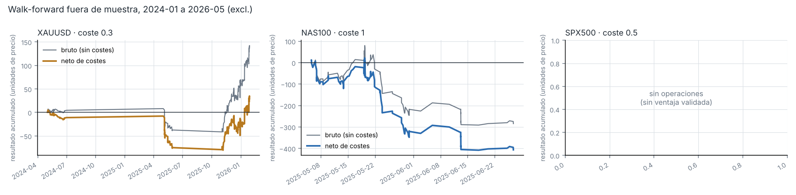
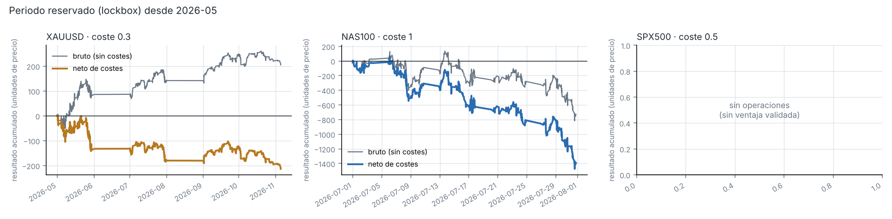

# claudio2 · predictor de movimientos para scalping (barras de 1 minuto)

Sistema completo para predecir el movimiento de los próximos 10 minutos y convertirlo en una
señal de scalping (COMPRAR / VENDER / ESPERAR con TP, SL y salida por tiempo), validado fuera de
muestra con costes de operación.

## Conclusión en corto

- **Mercado elegido: oro (XAUUSD).** De los tres candidatos es el único en el que el modelo
  encuentra una señal predictiva consistente fuera de muestra (acierta la dirección por encima
  del azar en el 79 % de los meses de diseño y en 6 de los 7 meses reservados).
- **La señal es real pero pequeña: no cubre los costes de una cuenta minorista.** Sin costes gana
  0,08 $ por onza y operación (t = 3,3 en 18 000 operaciones y 35 meses); el coste asumido de ida
  y vuelta es 0,30 $. En los meses reservados (may–nov 2026) el resultado neto fue **negativo**:
  −0,15 $ por operación, −213 $ por onza en total.
- **Nasdaq-100 y S&P 500: sin señal aprovechable** con datos de precio de 1 minuto.
- Por eso el modelo final publicado responde **ESPERAR** con el coste por defecto: solo emite
  órdenes si la validación encuentra ventaja neta para *tu* coste (`train --cost ...`). No hay
  evidencia de que este predictor sea rentable operando a mercado; úsalo como base de
  investigación, no como sistema para dinero real.

## Resultados

Walk-forward mensual: se entrena con los 12 meses anteriores, se opera el mes siguiente. Los
resultados están en unidades de precio del instrumento (en oro, $ por onza).

**Periodo de diseño** (ene-2024 a abr-2026, 28 meses)

| mercado | coste | IC | meses IC>0 | meses activos | ops | acierto | bruto/op | neto/op | neto total | t-stat |
|---|---|---|---|---|---|---|---|---|---|---|
| XAUUSD | 0,30 | 0,0128 | 79 % | 6/28 | 359 | 52,6 % | +0,381 | +0,081 | +29,1 | +0,39 |
| NAS100 | 1,00 | 0,0012 | 54 % | 2/28 | 122 | 44,3 % | −2,332 | −3,332 | −406,5 | −2,24 |
| SPX500 | 0,50 | 0,0015 | 64 % | 0/28 | 0 | – | – | – | 0 | – |



**Periodo reservado** (may-2026 a 6-nov-2026; no se usó para ninguna decisión y se evaluó una vez)

| mercado | coste | IC | meses IC>0 | meses activos | ops | acierto | bruto/op | neto/op | neto total | t-stat |
|---|---|---|---|---|---|---|---|---|---|---|
| XAUUSD | 0,30 | 0,0145 | 86 % | 5/7 | 1394 | 49,9 % | +0,147 | −0,153 | −213,1 | −1,43 |
| NAS100 | 1,00 | 0,0068 | 71 % | 1/7 | 660 | 49,1 % | −1,104 | −2,104 | −1388,3 | −1,94 |
| SPX500 | 0,50 | 0,0064 | 71 % | 0/7 | 0 | – | – | – | 0 | – |



**Sensibilidad al coste en oro** (ene-2024 a nov-2026; se repite todo el proceso con cada coste)

| coste ida y vuelta | meses activos | ops | acierto | bruto/op | neto/op | neto total | t-stat |
|---|---|---|---|---|---|---|---|
| 0 | 33/35 | 18 083 | 51,8 % | +0,080 | +0,080 | +1449,4 | +3,30 |
| 0,075 | 23/35 | 6 278 | 51,6 % | +0,136 | +0,061 | +382,3 | +1,03 |
| 0,15 | 20/35 | 4 700 | 50,6 % | +0,088 | −0,062 | −291,0 | −0,89 |
| 0,30 (supuesto) | 11/35 | 1 753 | 50,5 % | +0,195 | −0,105 | −184,0 | −1,10 |
| 0,60 | 1/35 | 40 | 70,0 % | +1,556 | +0,956 | +38,2 | +1,76 |

El punto de equilibrio está en torno a 0,08–0,10 $ por onza de coste total, por debajo de lo que
se paga cruzando el spread en CFD o en futuros (un tick de GC ya son 0,10 $). La fila de 0,60 son
40 operaciones en un solo mes: no es evidencia de nada.

IC = correlación de rangos entre predicción y resultado real. "Meses activos" = meses en los que
la validación encontró ventaja neta y el sistema operó; el resto se queda fuera.

## Cómo funciona

| pieza | archivo | qué hace |
|---|---|---|
| Datos | `scalper/data.py` | Histórico M1 2023→hoy de histdata.com (bid), últimos días de Yahoo (futuros) o tu CSV |
| Variables | `scalper/features.py` | 55 variables causales y adimensionales: momento/reversión a varios horizontes, régimen de volatilidad, forma de vela, posición en el rango, medias, RSI, hora y contexto de sesión |
| Objetivo | `scalper/labels.py` | Triple barrera: entrada en la apertura de la barra siguiente, TP = SL = volatilidad × √10, máximo 10 min. Si una barra toca ambas, se cuenta el stop |
| Modelo | `scalper/model.py` | LightGBM que estima el resultado esperado de un largo (negativo ⇒ corto). Umbral de entrada elegido en validación; si no hay ventaja neta, no opera |
| Backtest | `scalper/backtest.py` | Una posición a la vez, coste de ida y vuelta en cada operación, sin operar a través de cierres de sesión |
| Informe | `scalper/report.py` | Comparación de mercados, curvas y sensibilidad al coste |

Salvaguardas contra el autoengaño: purga de etiquetas solapadas entre entrenamiento, validación y
test; parámetros fijados antes de mirar el test; seis meses finales reservados; tests que
comprueban que las variables no miran al futuro y que en un paseo aleatorio no "aparece" ventaja.

También se probaron, solo sobre el periodo de diseño, horizontes de 5/20/30/60 min, un modelo más
regularizado, 24 meses de entrenamiento y variables de otros mercados (plata, EURUSD, USDJPY para
el oro; S&P para el Nasdaq). Ninguna cambió la conclusión, así que se mantuvo la configuración
inicial.

## Uso

```bash
pip install -r requirements.txt
python -m scalper download                 # histórico M1 de los tres mercados (~1,3 M de barras cada uno)
python -m scalper compare                  # walk-forward y ranking en el periodo de diseño
python -m scalper lockbox                  # evaluación en los meses reservados
python -m scalper train --market XAUUSD --cost 0.30   # modelo final con TU coste real
python -m scalper predict --market XAUUSD             # señal con datos de Yahoo
python -m scalper predict --market XAUUSD --csv barras_mt5.csv --tz Europe/Athens --loop
pytest -q
```

Ejemplo de salida:

```
[2026-11-10 19:03:00+00:00] XAUUSD cierre=4035.30  pred=-0.0299 (umbral sin ventaja validada)  sesgo=neutral  => ESPERAR
```

## Limitaciones

- Los costes (`scalper/config.py`) son supuestos; mide el spread y la comisión reales de tu bróker.
- El histórico es cotización bid sin volumen ni libro de órdenes. El flujo de órdenes es justo la
  información que más ayuda a esta escala y aquí no está.
- Yahoo sirve los futuros con ~10 minutos de retraso: vale para probar, no para operar. Para
  tiempo real hay que alimentar `predict --csv` (o `model.live_signal`) con barras del bróker.
- El backtest asume ejecución en la apertura de la barra siguiente sin deslizamiento adicional al
  coste fijo; en noticias el deslizamiento real es mayor.
- El reloj de histdata no es el "EST fijo" que documenta: se corrigió contrastándolo con Yahoo.

Esto es software de investigación, no asesoramiento financiero.
